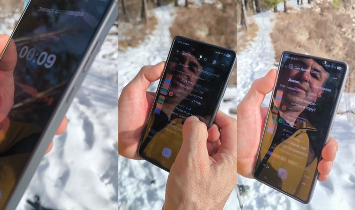

# Материалы демонстрации

## Видео: живой телефон, улица, человек со стороны

[`demo_1_real.mp4`](demo_1_real.mp4) — 2 мин 10 с.

**Снимали не мы.** APK отправили человеку, который ничего не знал о проекте и не видел его раньше. Он сам
установил приложение на свой телефон, без подсказок записал разговор прямо на улице, в зимнем походе (ветер,
шаги по снегу, без внешнего микрофона), и получил расшифровку с разделением по говорящим — всё на телефоне,
без интернета. Это и есть проверка «работает у постороннего человека в реальных условиях», а не на стенде.

## Скриншоты с эмулятора x86_64 (4 ГБ, как у проверяющих)

| Файл | Экран |
|---|---|
| `s01_onboarding.png` | Онбординг |
| `s03_record.png` | Запись с микрофона |
| `s06_transcript_x86_64.png` | Результат: «Диалог» с лентой спикеров |
| `s06_playback.png` | Проигрывание реплики, мини-плеер |
| `s06_named_speaker.png` | «Стенограмма» с переименованным говорящим |
| `s07_rename.png` | Переименование говорящего |
| `s08_protocol_generating.png`, `s08_protocol.png` | Протокол встречи (локальная LLM) |
| `app_icon.png` | Иконка приложения |
